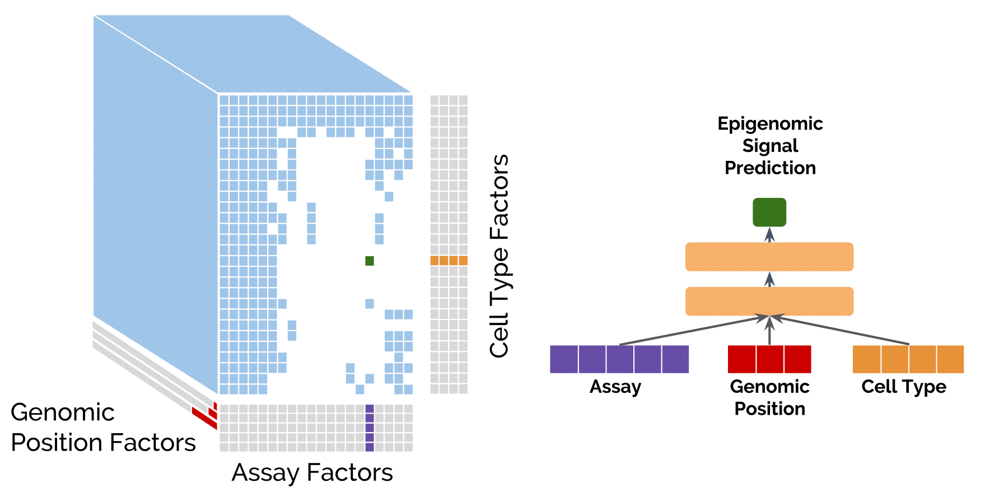
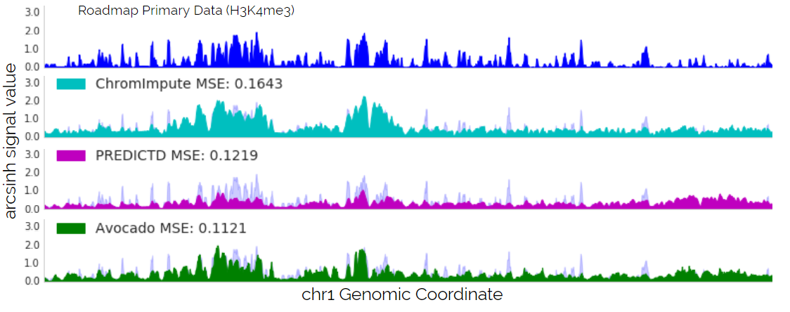
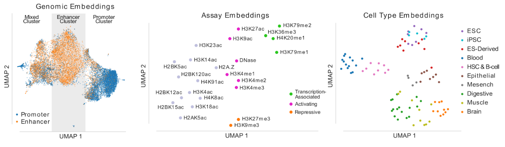

## avocado

> **Deprecated.** This code base is no longer maintained, and version 0.4.1 is its final release. This release documents the code as it stands, pins the dependencies to versions that still work together, and lists the [known issues](#known-issues) instead of fixing them. Avocado is going to be completely refactored, and code written against this version may not work with the refactored package. If you depend on this version, pin it with `pip install avocado-epigenome==0.4.1`. The version history is in [CHANGELOG.md](CHANGELOG.md).

<p align="center">
	
</p>

Avocado is a multi-scale deep tensor factorization method for learning a latent representation of the human epigenome. The purpose of this model is two fold; first, to impute epigenomic experiments that have not yet been performed, and second, to learn a latent representation of the human epigenome that can be used as input for machine learning models in the place of epigenomic data itself. 

This approach has been used in several contexts. If available, the pre-trained models and resulting imputations are below.

1. [**Multi-scale deep tensor factorization learns a latent representation of the human epigenome**](https://genomebiology.biomedcentral.com/articles/10.1186/s13059-020-01977-6) [**[model]**](https://zenodo.org/record/4774412) [**[imputations]**](https://www.encodeproject.org/publication-data/ENCSR617ILB/)  <br>

This model was trained on 1,014 tracks of epigenomic data from the Roadmap Epigenomics Mapping Consortium (REMC) that include chromatin accessibility (DNase-seq) and 23 tracks of histone modification (ChIP-seq) from 127 human primary cell lines and tissues. <br>

2. [**Completing the ENCODE3 compendium yields accurate imputations across a variety of assays and human biosamples**](https://genomebiology.biomedcentral.com/articles/10.1186/s13059-020-01978-5) [**[ENCODE2018Core Model]**](https://zenodo.org/record/4774521) [**[ENCODE2018Full Model]**](https://noble.gs.washington.edu/proj/avocado/models/encode2018full/) [**[imputations]**](https://www.encodeproject.org/publication-data/ENCSR481OSA/)

This model was trained on 3,814 tracks of epigenomic data from the ENCODE Compendium that include chromatin accessibility (DNase-seq and ATAC-seq), measurements of gene transcription (including CAGE, RAMPAGE, polyA-depleted, etc.), histone modifications, and DNA-binding proteins such as transcription factors. The ENCODE2018Full model link now returns HTTP 403 (see [Pre-trained models](#pre-trained-models)).

3. [**Zero-shot imputations across species are enabled through joint modeling of human and mouse epigenomics**](https://www.biorxiv.org/content/10.1101/801183v1)

This model was trained using 1,145 tracks of epigenomic data from mice and 6,870 tracks of epigenomic data from the ENCODE Compendium (see 2). The model is designed to make imputations in mice by leveraging the large amount of high quality human epigenomic data that has already been collected.

#### Installation

Avocado can be installed using pip.

```
pip install avocado-epigenome
```

or with uv, in an environment with Python 3.8 or older:

```
uv venv --python 3.8
uv pip install avocado-epigenome
```

Avocado is built on multi-backend Keras 2 with the Theano backend, neither of which is maintained. Version 0.4.1 pins its dependencies to the versions that still work together, and each upper bound below is a failure observed when it was lifted:

| Requirement | Reason |
|---|---|
| `keras >= 2.0.8, < 2.4` | Keras 2.4 and later require TensorFlow and have no Theano backend. |
| `numpy >= 1.14.2, < 1.22` | Theano 1.0.5 fails on import with numpy 1.22 and later (`module 'numpy.distutils.__config__' has no attribute 'blas_opt_info'`). |
| `h5py < 3` | Keras 2.3.1 cannot load a saved model with h5py 3 (`'str' object has no attribute 'decode'`). |
| Python `< 3.9` | h5py 2.10.0, the last release below 3, has no wheels for Python 3.9 or later, and building it from source failed. |

Version 0.4.1 was tested on Linux, on the CPU, with Python 3.8.20, Keras 2.3.1, Theano 1.0.5, h5py 2.10.0, numpy 1.21.6, pandas 2.0.3 and pyBigWig 0.3.22. GPU execution and Python 2 were not tested.

Keras 2.3.1 uses the TensorFlow backend unless told otherwise, and TensorFlow is not a dependency, so `import avocado` and `avocado-impute` both fail with `ModuleNotFoundError: No module named 'tensorflow'` until the Theano backend is selected. Select it before running either:

```
export KERAS_BACKEND=theano
```

or set `"backend": "theano"` in `~/.keras/keras.json`, which Keras writes the first time it is imported.

### Pre-trained models

`avocado-impute -m` names five pre-trained models. Their files were served from noble.gs.washington.edu, which now serves only the Roadmap model. As of 2026-10-18:

| `-m` | Model | Chromosomes | Where to get it |
|---|---|---|---|
| `roadmap-hg19` | Roadmap, hg19 | chr1-22 | Downloaded automatically by `avocado-impute`; also on [Zenodo](https://zenodo.org/record/4774412) |
| `encode2018core-hg38` (default) | ENCODE Core, hg38 | chr1-22, chrX | [Zenodo](https://zenodo.org/record/4774521) only; noble.gs.washington.edu returns 403 |
| `encode2018full-hg38` | ENCODE Full, hg38 | | Not available; noble.gs.washington.edu returns 403 |
| `entex2019-hg38` | ENTEx, hg38 | | Not available; noble.gs.washington.edu returns 404 |
| `encode2019mouse-mm10` | ENCODE mouse, mm10 | | Not available; noble.gs.washington.edu returns 403 ([#20](https://github.com/jmschrei/avocado/issues/20)) |

Each Zenodo record holds one `avocado-chr<N>.json` and `avocado-chr<N>.h5` pair per chromosome and the chromosome sizes file, which is the layout `avocado-impute -p` expects. The ENCODE Core record also holds the model trained on the pilot regions (`avocado-pilot`).

### Imputing epigenomic data

Avocado can impute genome-wide epigenomic and transcriptomic experiments that have not yet been performed, allowing for the computational characterization of human epigenomics on a massive scale. These imputations are of -log10 p-values at 25 bp resolution that have been arcsinh transformed to stablize the variance and are generally high quality when compared with competing methods. Below is an example of the imputation of H3K4me3 in IMR90 from ChromImpute, PREDICTD, and Avocado as well as the MSE of the imputations in the displayed region. The experimental signal is shown in faded blue in each panel to compare to the imputations.

<p align="center">
	
</p>

Imputations can be made in two ways. The first is the command line tool that is available in the `cli` folder and the second is using the Python interface.

##### Command Line Interface (CLI)

<i>This is the easiest way to get imputations.</i>

Once you install the Avocado package you will be able to use the command line to make imputations using a pre-trained model. Detailed usage instructions can be found in the README in the `cli` folder. Briefly, the user specifies the model to make imputations from (either those from the papers above or from a local directory) and the experiments to be imputed and the result will be the corresponding bigwig files. If a model's files are not in the model directory, the program tries to download them from noble.gs.washington.edu, which now works only for the Roadmap model (see [Pre-trained models](#pre-trained-models)).

The following commands would make predictions for the transcription factor REST in HepG2 using an Avocado model that has been pre-trained using ENCODE data (the default). Because that model is no longer served from noble.gs.washington.edu, the `wget` commands first download it from Zenodo (about 43 GB) into a directory that is then passed in with `-p`.

```
mkdir -p encode2018core
for chrom in $(seq 1 22) X; do
	for ext in json h5; do
		wget -O encode2018core/avocado-chr${chrom}.${ext} https://zenodo.org/api/records/4774521/files/avocado-chr${chrom}.${ext}/content
	done
done
wget -O encode2018core/hg38.chrom.sizes https://zenodo.org/api/records/4774521/files/hg38.chrom.sizes/content

export KERAS_BACKEND=theano
avocado-impute -p encode2018core -c J040 -a ChIP-seq_REST_signal_p-value -d cpu
```

`-d cpu` runs the imputation on the CPU. The default, `-d cuda`, needs pygpu, which is not installed with this package (see [Known issues](#known-issues)). On the CPU, Theano used one core in testing, and predicting 100,000 bins (2.5 Mbp) of one experiment with the ENCODE Core or Roadmap model took about 100 seconds.

All cell types and assays that imputations can be made for can be found in the `cli` folder.

##### Python Interface

Making imputations in Python using a pre-trained model requires only two lines of code; one that loads the model, and one that calls the predict method. We can start by loading up the [pre-trained model](https://noble.gs.washington.edu/proj/avocado/model/) from Roadmap for chromosome 19.

```python
>>> from avocado import Avocado
>>> model = Avocado.load("avocado-chr19")
```

This will create a model with the architecture specified in `avocado-chr19.json` and load the weights from the file `avocado-chr19.h5`. 

Now, we can use this model to impute values for any combination of cell type and assay that are contained in the model. The attributes `model.celltypes` and `model.assays` should list those that are contained in the model. 

```python
>>> track = model.predict("E004", "H3K36me3")
>>> track
array([ 0.11702164,  0.12218985,  0.12052222, ..., -0.06277317,
       -0.06284004, -0.06013602], dtype=float32)
```

This will yield imputations at 25 bp resolution across chromosome 19 for the assay H3K36me3 in cell type E004. These imputations will be the same as the ones provided in the [imputations folder](https://noble.gs.washington.edu/proj/avocado/data/avocado_full/), which now returns HTTP 403. 

```python
>>> import numpy
>>> data = numpy.load("H3K36me3/E004.H3K36me3.chr19.avocado.npz")['arr_0']
>>> data
array([ 0.11702165,  0.12218987,  0.12052223, ..., -0.06277314,
       -0.06284001, -0.06013602], dtype=float32)
```

Note that because the genome is so long the genome factors cannot fit entirely in memory. Accordingly, we have split the model into one file per chromosome, where the neural network parameters, cell type embedding, and assay embedding are shared from one chromosome to the next. In order to make imputations genome-wide, one would need to load up and then make imputations for each chromosome separately.

### Using the learned latent representation

<p align="center">
	
</p>

During the training process, Avocado learns a low-dimensional latent representation of each axis of the tensor: the cell types, the assays, and the genomic positions. Each axis is independent of the other two; for example, the representations of genomic positions is based on data from all available assays in all cell types. Thus, the learned genome representation is a distillation of information across all cell types and assays. 

Projections of the learned genomic position, cell type, and assay representations are shown above for the model trained using Roadmap data. In each panel, a point corresponds to either a single genomic locus, assay, or cell type. 

All three embeddings can be extracted from the commands using the following simple commands to first load a model and then extract the relevant embedding:

```python
>>> from avocado import Avocado
>>> model = Avocado.load("avocado-chr1")
>>> genome_embedding = model.genome_embedding
>>> celltype_embedding = model.celltype_embedding
>>> assay_embedding = model.assay_embedding
```

The cell type and assay embeddings will return simply the learned embeddings from the model. The genome embedding will consist of the 25 bp, the 250 bp, and the 5 kbp factors concatenated together at 25 bp resolution such that 10 positions in a row share the same values for the 250 bp factors and 200 positions in a row share the same 5 kbp factor values. The genome embedding is a float64 array with one row per 25 bp bin, so for a large chromosome it takes several gigabytes of memory.

### Training a new model

Using Avocado is easy! We can initialize the model just by passing in a list of cell types, a list of assays, and specifying the various hyperparameters. The defaults for all of the hyperparameters are those that were used in the manuscript. Here is an example of creating a very small model that could potentially be trained on a CPU.

```python
>>> from avocado import Avocado
>>> 
>>> celltypes = ['E003', 'E017', 'E065', 'E116', 'E117']
>>> assays = ['H3K4me3', 'H3K27me3', 'H3K36me3', 'H3K9me3', 'H3K4me1']
>>> 
>>> model = Avocado(celltypes, assays, n_layers=1, n_nodes=64, n_assay_factors=24, 
				n_celltype_factors=32, n_25bp_factors=5, n_250bp_factors=20, 
				n_5kbp_factors=30, batch_size=10000)
```

The format of the training data is that of a dictionary where the keys are (cell type, assay) pairs and the value is the corresponding track of epigenomic data. The tracks for these cell types and assays are in the `data` folder.


```python
>>> import itertools
>>> import numpy
>>> 
>>> data = {}
>>> for celltype, assay in itertools.product(celltypes, assays):
>>>	if celltype == "E065" and assay == "H3K4me3":
>>>		continue
>>>	filename = 'data/{}.{}.pilot.arcsinh.npz'.format(celltype, assay)
>>> 	data[(celltype, assay)] = numpy.load(filename)['arr_0']
```

Now you can fit your model to that data for some number of epochs, where an epoch is defined as some number of batches. Typically one wants to balance the epoch size and the batch size such that one epoch is equal to one pass over the genomic axis. The default training generator scans sequentially through the genome, randomly selecting experiments in the training set to train on at each position.

```python
>>> model.fit(data, n_epochs=10, epoch_size=100)
```

After you're done fitting your model you can then impute any track from the cell types and assays that you trained on. In this case we trained on every track except H3K4me3 in E065, which is the one imputed here, but this can be as dense or sparse as one would like as long as there is at least one example of each cell type and assay.

```python
>>> track = model.predict("E065", "H3K4me3")
```

There are currently two tutorials in the form of Jupyter notebooks. One focuses on how to use this code to train an Avocado model, make imputations, and extract the resulting latent factors. The second shows how one might use the latent factors to make predictions in two downstream tasks. Both notebooks were run with a Python 2.7 kernel and were not re-run for version 0.4.1.

<p align="center">
	
</p>

### Can I add my own cell type and assay to your model?

Yes! The model is flexible enough to allow one to easily add in new cell types or assays without needing to retrain all of the parameters. The procedure is essentially to freeze the latent factors on the genome axis, the neural network parameters, and the latent factors in the assay embedding if you're adding in a new cell type or in the cell type embedding if you're adding in a new assay. Then, one can learn the latent factors corresponding either to the cell types or assays to be added in. This works because the frozen neural network parameters ensure that the new embedding is comparable to the old one. In fact, this is how we learn genomic representations that are comparable from one chromosome to another despite training the representations independently.

Programmatically there is a built-in function that allows you to pass in data for new cell types or assays and learn their respective embeddings. All you have to do to add in new cell types is make a data dictionary with the same format as training the model like the normal `fit` method except that the cell types are all new and the assays are those that are already in the model. The tracks for E004 are not in the `data` folder.

```python
>>> data = {}
>>> for assay in assays:
>>>	filename = 'E004.{}.pilot.arcsinh.npz'.format(assay)
>>>	data[('E004', assay)] = numpy.load(filename)['arr_0']
>>>
>>> model.fit_celltypes(data, n_epochs=5)
```

The model will freeze all the parameters and only learn the embeddings for the new cell types (or assays if you use `fit_assays` instead). Once those new embeddings are used you can impute any epigenomic experiments for the new cell types just as if they were part of the original model!

### Known issues

These are the known problems in version 0.4.1. They are documented here rather than fixed, because this code base is going to be replaced.

**Environment**

- Keras 2.3.1 uses the TensorFlow backend by default, so `KERAS_BACKEND=theano` must be set (see [Installation](#installation)).
- `avocado-impute` defaults to `-d cuda`, which needs pygpu, and pygpu is not a dependency of this package. Without pygpu, Theano logs `pygpu was configured but could not be imported` and runs on the CPU if setuptools is installed. If setuptools is not installed, as in a virtual environment made by uv, it raises `ModuleNotFoundError: No module named 'pkg_resources'` instead. `-d cpu` avoids both.

**Downloads**

- Four of the five models that `avocado-impute -m` names can no longer be downloaded from noble.gs.washington.edu (see [Pre-trained models](#pre-trained-models)). The imputations folder linked under Python Interface returns HTTP 403 as well.
- When a model download fails, `avocado-impute` does not stop. It prints the `wget` errors, creates the output bigWig, and then raises `OSError: Model file for chromosome chr1 not found.`, leaving a bigWig with a header and no values.

**`avocado-impute`**

- With `-m custom` and no `-s/--chrom_sizes`, it raises `TypeError: stat: path should be string, bytes, os.PathLike or integer, not NoneType`.
- When `-s/--chrom_sizes` is given, or with `-m custom`, no download location is set, so a model directory that is missing any chromosome's `.json` file raises `AttributeError: 'Namespace' object has no attribute 'download_path'`, with or without `-k`.
- `-k/--skip_missing` skips a chromosome only when its `.json` file is missing. A missing `.h5` file raises `OSError: Unable to open file` from h5py.
- The last bin that the model predicts for each chromosome is not written to the bigWig. The ENCODE Core models end each chromosome with a bin that extends past the chromosome end, so for them this drops that partial bin. The Roadmap models end at the last complete bin, so for them the last 25 bp bin of each chromosome is missing from the bigWig.

**Python API**

- On Python 3, passing `X_valid` to `fit`, `fit_celltypes` or `fit_assays` raises `TypeError: 'dict_keys' object is not subscriptable` at the end of the first epoch.
- `fit(sampling='random')` uses the same generator as `sampling='permuted'`, and any value other than `'sequential'`, `'permuted'` or `'random'` raises `UnboundLocalError`.
- `fit_celltypes` and `fit_assays` do not add the new experiments to `model.experiments`, so `save` writes the experiments from before the call.
- `Avocado.load` accepts `freeze_*` arguments but does not apply them to the layers of the loaded model.
- `Avocado.get_params` raises `NameError: name 'model' is not defined`.
- `avocado.utils` cannot be imported on Python 3 (`TypeError: unsupported operand type(s) for +: 'range' and 'list'`), and `download_bigWig` refers to the undefined names `bigWig` and `chromosome_lengths`, so it raises `NameError` wherever the module can be imported ([#3](https://github.com/jmschrei/avocado/pull/3)). `import avocado` does not import this module.
